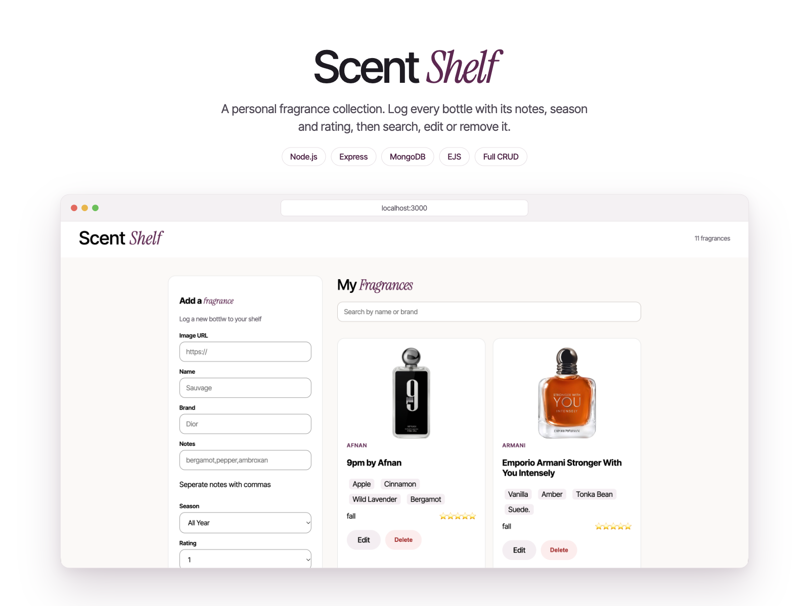

# ScentShelf

ScentShelf is a personal fragrance collection manager. Keep a shelf of your fragrances with their brand, notes, season, and rating.

## Demo



## Features

- Add fragrances with an image URL, name, brand, notes, season, and rating.
- Browse fragrances sorted by rating.
- Search the collection by fragrance name.
- Delete fragrances from the collection.

## Built with

- Node.js and Express
- MongoDB with Mongoose
- EJS templates
- Plain JavaScript and CSS

## Getting started

### Prerequisites

- Node.js and npm
- A MongoDB database and connection URI

### Installation

1. Clone the repository and move into the project directory.
2. Install the dependencies:

   ```bash
   npm install
   ```

3. Create a `.env` file in the project root and add your MongoDB connection URI:

   ```env
   MONGODB_CONNECTIION=mongodb+srv://<username>:<password>@<cluster>/<database>?retryWrites=true&w=majority
   ```

   The variable name is spelled `MONGODB_CONNECTIION` to match the current server configuration. Replace the URI placeholders with your database connection details. The app reads and writes fragrance documents in the `ScentShelf` collection within the database specified by your URI.

4. Start the server:

   ```bash
   node server.js
   ```

5. Open [http://localhost:8001](http://localhost:8001) in your browser.

## Using the app

Fill out the add-fragrance form and submit it to add an item to your shelf. Enter fragrance notes as a comma-separated list. Use the search field to filter by fragrance name, or choose **Delete** on a fragrance card to remove it.
